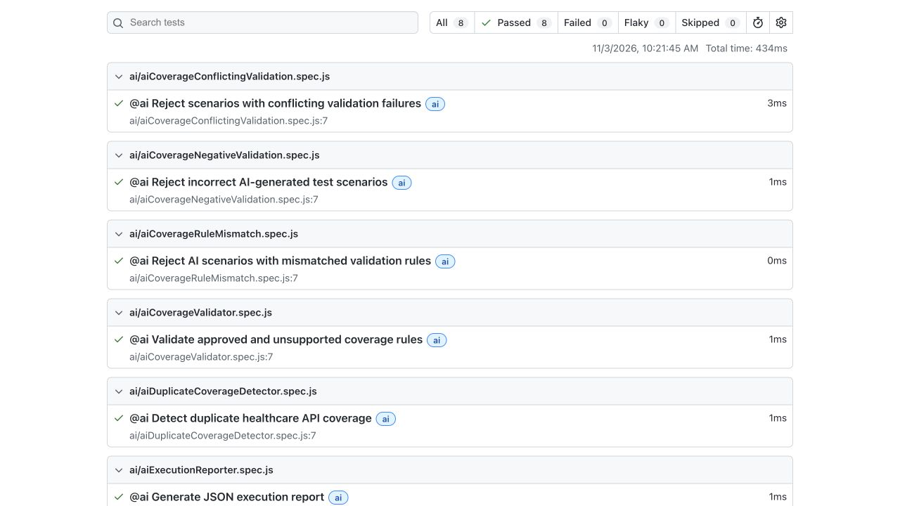

# AI Healthcare Quality Automation Platform

[](https://github.com/kilicerdal/ai-healthcare-quality-platform/actions/workflows/playwright.yml)

A Senior SDET portfolio project demonstrating API automation, database testing, event-driven integration testing, AI-assisted quality engineering, and CI/CD.

## See the results



[75-second captioned walkthrough](docs/media/walkthrough.webm?raw=true) · [Download sample HTML report ZIP](docs/samples/ai-validation-report.zip?raw=true)

The screenshot and report show eight deterministic AI validation tests run locally on November 3, 2026. This is a selected subset, not the full regression suite or a live Ollama demonstration. Extract the ZIP and open `index.html` to inspect the checks. The walkthrough uses actual report screenshots, with captions and no narration.

The complete Docker setup and regression suite also passed in [CI run 41663498497](https://github.com/kilicerdal/ai-healthcare-quality-platform/actions/runs/41663498497).

## Review the code

| Example                                                             | What it demonstrates                                       |
| ------------------------------------------------------------------- | ---------------------------------------------------------- |
| [Claims API](app/server.js)                                         | Input validation, parameterized SQL, and response handling |
| [API validation tests](tests/api/claimsValidation.spec.js)          | Invalid inputs and boundary conditions                     |
| [Contract tests](tests/contract/claimsContract.spec.js)             | Response schema validation                                 |
| [Database tests](tests/database/claimsDatabase.spec.js)             | Persisted claim verification                               |
| [SQS ingestion tests](tests/e2e/sqsClaimsIngestion.spec.js)         | Event-driven integration using simulated AWS services      |
| [AI scenario validator tests](tests/ai/aiScenarioValidator.spec.js) | Validation of AI-generated scenarios                       |
| [CI workflow](.github/workflows/playwright.yml)                     | PostgreSQL/Moto setup, execution, and reports              |

## Technology Stack

| Technology             | Purpose                          |
| ---------------------- | -------------------------------- |
| Playwright             | API and end-to-end automation    |
| JavaScript / Node.js   | Automation framework and backend |
| Express                | Healthcare claims REST API       |
| PostgreSQL             | Database validation              |
| AWS SDK                | S3 and SQS integration           |
| Moto                   | Local AWS service simulation     |
| Ollama / Qwen2.5-Coder | AI-assisted testing              |
| GitHub Actions         | CI/CD automation                 |

## Architecture

```text
                 Playwright Test Framework
                           |
              +------------+------------+
              |                         |
              v                         v
        Healthcare API             AI Test Layer
              |                         |
              v                  Ollama / Qwen2.5
         PostgreSQL
              ^
              |
       Claims Processor
              ^
              |
          S3 / SQS
       (Moto Simulator)
```

## Automated Test Suites

| Suite                                  | Command                   |
| -------------------------------------- | ------------------------- |
| Smoke                                  | `npm run test:smoke`      |
| Sanity                                 | `npm run test:sanity`     |
| Regression (excludes tests tagged @ai) | `npm run test:regression` |
| AI directory                           | `npm run test:ai`         |
| Contract                               | `npm run test:contract`   |

Suite selections can overlap. For current discovered tests, run `npx playwright test --list`; for executed totals and outcomes, inspect the corresponding CI run. Static test totals are omitted because the suite is evolving.

## Test Coverage

- JSON Schema contract validation using AJV
- Healthcare API health checks
- Claim creation and retrieval
- Missing required field validation
- Negative and zero claim amount validation
- Invalid claim amount validation
- Invalid service date validation
- Boundary value testing
- PostgreSQL data persistence
- S3 upload and retrieval
- S3-to-PostgreSQL processing
- SQS event-driven processing
- Risk-based test selection
- AI-assisted test generation
- AI-assisted failure analysis
- AI risk explanation

## AI-Assisted Testing

The framework integrates a locally hosted Ollama model.

AI supports test generation, failure analysis, and risk explanations. Deterministic code controls test selection and test assertions.

AI-generated recommendations do not automatically become application requirements.

## CI/CD Pipeline

The [Healthcare Quality Automation workflow](.github/workflows/playwright.yml) runs on pushes to `main` and `fix/**`, pull requests to `main`, and manual dispatch.

It provisions PostgreSQL and Moto, creates the claims table and simulated S3/SQS resources, starts the API, runs regression tests, and runs selected deterministic AI validation tests. Test artifacts and server logs are uploaded for investigation.

Tests that call a live local Ollama model require that service separately. The deterministic AI validation subset in CI does not imply that every model-dependent test runs there.

## One-command demo environment

Requires Docker with Compose v2, Node.js 24, npm, and available local ports 3000, 5000, and 5432.

```bash
npm ci
npm run demo:up
npm run demo:test
npx playwright show-report
```

`demo:up` builds the API, starts PostgreSQL and Moto, and initializes the claims table, S3 bucket, and SQS queue. The command waits for service health checks. `demo:test` runs serially against these local services. Ollama-dependent tests are a separate workflow.

```bash
npm run demo:down
```

Stopping preserves the PostgreSQL volume. The credentials are local demo values and ports bind to loopback. This environment uses synthetic data and is intended for local development. If a port is occupied, stop the conflicting service first. Container startup is validated by the [Demo environment workflow](.github/workflows/demo-environment.yml).

## Local Setup

Prerequisites:

- Node.js 24 (matching CI)
- PostgreSQL
- Docker-compatible container runtime
- Moto for simulated AWS services
- Ollama for AI tests

Clone the project and install dependencies:

```bash
git clone https://github.com/kilicerdal/ai-healthcare-quality-platform.git
cd ai-healthcare-quality-platform
npm ci
```

Before running the full regression suite, initialize PostgreSQL, the claims table, Moto, the `healthcare-claims-local` bucket, and the `healthcare-claims-queue` queue. The [CI workflow](.github/workflows/playwright.yml) contains the reference schema and initialization commands. Database connections use `DB_HOST`, `DB_PORT`, `DB_NAME`, `DB_USER`, and `DB_PASSWORD`; configure these for your local environment.

Start the healthcare API in a separate terminal after initializing the database:

```bash
npm run db:migrate
node app/server.js
```

Run regression tests:

```bash
npm run test:regression
```

Run AI tests:

```bash
npm run test:ai
```

## Reliability checks

```bash
npm run test:unit
```

These deterministic tests cover malformed queue messages, batch continuation, storage/API failures, acknowledgement failures, and invalid AI scenarios without Docker or a live model. CI runs them before integration tests.

Queue processing acknowledges only successfully processed messages. It continues with later messages when an earlier one fails, then throws an `AggregateError` containing the causes and the successfully acknowledged `processedClaims`. Failed messages remain available for queue retry. Delivery remains at-least-once; the API uses a database unique index and atomic upsert to avoid duplicate claims for a repeated idempotency key. Queue ingestion now uses an idempotency key derived from the S3 bucket and object key. Identical retries return the original claim; a changed payload at the same key returns HTTP 409. A deployed dead-letter queue remains future work.

The SQS ingestion test creates a unique temporary queue. S3 ingestion and database verification tests use unique synthetic member IDs and clean up their records and objects in `finally` blocks. Other API tests still use a disposable test database; cleanup is not yet universal.

For an interview walkthrough, see [engineering decisions and failure cases](docs/ENGINEERING.md).

## Security

- Synthetic healthcare data only
- No real patient information
- AWS services simulated locally using Moto
- No production AWS credentials required
- No real AWS cloud deployment

## Project Goals

Demonstrate Senior SDET capabilities in:

- Automation framework architecture
- API and database testing
- Cloud integration testing
- CI/CD implementation
- AI-assisted quality engineering
- Risk-based testing
- Test reporting and failure analysis

## Retry contract

`POST /api/claims` accepts an optional `Idempotency-Key` header (up to 128 characters). The same key and normalized claim fields return the original claim with HTTP 201, including concurrent requests. Reusing the key with different claim fields returns HTTP 409. Requests without the header retain ordinary create behavior. Startup applies additive schema migrations, including existing Docker volumes.

Queue ingestion derives the key from the bucket and object key. Use immutable, unique object keys for distinct claims. Deduplication lasts while the claim row is retained; this is not an exactly-once delivery guarantee.

## CI report access

Open the GitHub Actions run summary for pass, fail, flaky, and skipped execution counts. If an earlier step prevents a suite from running, the summary marks its report as not generated. Download the report artifact and open its HTML report to inspect test steps and generated failure artifacts. These execution counts are not code coverage percentages.
